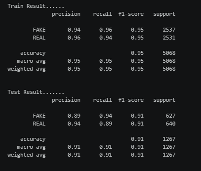
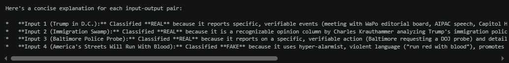

# Fake News Detection using Machine Learning

This project is a Fake News Detection system developed using Python, Natural Language Processing (NLP), and Machine Learning.

I built this project to classify news articles as Fake or Real based on their text content. The model uses TF-IDF Vectorization to convert text into numerical features and Logistic Regression to predict the news category.

## About the Dataset

The project uses a news dataset containing articles labeled as:

- Fake News
- Real News

The text data is cleaned and preprocessed before training the model.

## Technologies Used

- Python
- Pandas
- Scikit-learn
- NLP
- TF-IDF Vectorizer
- Logistic Regression
- Joblib
- Jupyter Notebook

## Project Workflow

1. Load and explore the news dataset.
2. Clean and preprocess the text data.
3. Split the dataset into training and testing sets.
4. Convert text into numerical features using TF-IDF.
5. Train the Logistic Regression model.
6. Evaluate the model using accuracy, precision, recall, and F1-score.
7. Save the trained model using Joblib.
8. Predict whether new news articles are Fake or Real.

## Features

- Fake and Real news classification
- NLP-based text processing
- TF-IDF feature extraction
- Logistic Regression model
- Model evaluation and performance analysis
- Prediction on custom news articles

## Model Performance

The model is evaluated using a classification report.



## Sample Predictions

The trained model can classify new news articles as Fake or Real.



## Project Structure

```text
Fake_News_Detection/
│
├── FakeRealNews.ipynb
├── FakeReal_Pred.ipynb
├── FakeNews.csv
├── fake_news_model.pkl
├── classification.png
├── output.png
├── requirements.txt
└── README.md
```

## How to Run

**1. Clone the repository**

```bash
git clone https://github.com/SachinDevarajan/Fake_News_Detection.git
cd Fake_News_Detection
```

**2. Install the required libraries**

```bash
pip install -r requirements.txt
```

**3. Run the training notebook**

```bash
jupyter notebook FakeRealNews.ipynb
```

**4. Run the prediction notebook**

```bash
jupyter notebook FakeReal_Pred.ipynb
```

## What I Learned

Through this project, I gained practical experience in:

- Natural Language Processing
- Text cleaning and preprocessing
- TF-IDF Vectorization
- Logistic Regression
- Binary classification
- Machine Learning model evaluation
- Saving and loading trained models using Joblib

## Author

**Sachin Devarajan**

GitHub: [SachinDevarajan](https://github.com/SachinDevarajan)

LinkedIn: [Sachin Devarajan](https://linkedin.com/in/sachindevarajan)
